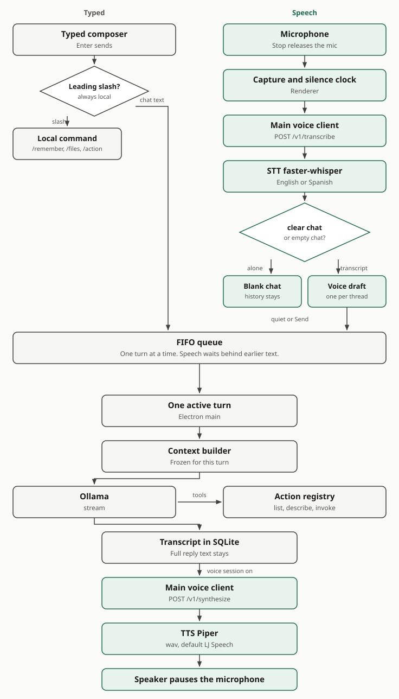

# Verbo

**Think out loud.**

Verbo is a local AI chat app for exploring ideas, making things, and questioning assumptions. It runs as an Electron desktop app, uses Ollama for inference, and saves conversations on your machine. Speech recognition and spoken replies stay on a separate local voice service. A textured background, translucent surfaces, and restrained color keep the interface quiet while giving it a little character. No hosted AI account or API key is required.

## Features

### Conversations

- **Local answers:** Ollama handles inference; the backend releases answer text after a tool-free response completes. While the microphone is live, the composer square stops listening and leaves a turn already sent to Ollama running. **Stop generating** cancels that turn, including one waiting on approval.
- **Editable starting points:** “Explore an idea,” “Create something,” and “Challenge a belief” fill the composer with a prompt you can change before sending.
- **Iteration:** edit a user message, regenerate an assistant response, and navigate alternative message branches using assistant-ui controls.
- **Markdown:** answers support headings, lists, tables, links, blockquotes, and fenced code blocks through GitHub-flavored Markdown.
- **Copy and export:** copy an answer or code block, or export an assistant message as Markdown from its action menu.
- **A persistent composer:** the input stays available while a reply, tool round, or approval is in progress. A control returns you to the latest messages.

Titles are generated locally from the first user message using the selected Ollama model. Title generation uses a separate, non-streaming request with thinking disabled and a short timeout. If it fails or produces an unusable title, the conversation keeps its fallback `Chat …` title.

Each turn freezes its instructions, settings, and always-on memory, then keeps about a quarter of the context window free. The latest user message, open tool or approval state, and the newest history come first. Older messages stay in SQLite when they are left out of a request. Meters show a character estimate and the last Ollama prompt count when a turn reported one.

The model can call four tools: `capabilities.list`, `capabilities.search`, `capabilities.describe`, and `actions.invoke`. They discover and run the same registered commands as human routes. The backend withholds model text until a tool-free response completes and all commands or approvals settle. Tool receipts are stored with the turn.

The main Controller saves a canonical final response before releasing the queue. A storage failure shows **Retry saving response**; recovery saves the frozen result without rerunning models or commands, including after restart. Versioned workflows handle conversation, commands and Obsidian notes by default; `VERBO_WORKFLOW_V1=0` selects the compatibility worker. Obsidian's explicit command wrappers expose qualified read/create/move/rename operations, with installation-specific activation and normal permissions/approvals. Full edit and system-trash equivalence remain unsupported. See [turn lifecycle and workflows](docs/turn-runtime.md).

### Conversation history

Create, switch, search by title, rename, archive, and delete conversations from the sidebar. Threads, messages, memory, file scopes, mutation plans, the turn queue, and voice drafts are stored in SQLite and loaded when you return.

### Memory

`/remember <text>` saves a global note for Conversational without calling Ollama. Settings → Commands → Memory lists, edits, and removes entries, and assigns recipients individually or to the displayed unassigned group. Legacy notes stay unassigned and uninjected until you choose recipients; new notes visibly default to Conversational. Always-on context has a budget of about 512 estimated tokens per recipient. Other notes are on demand. The top-level Memory tab and `/memories` open memory settings; `/forget <id>` removes an entry.

### Files and changes

Folders marked as Obsidian vaults require the qualified Obsidian backend for mutations, including through generic file commands. That integration remains disabled pending rollout acceptance; unsupported operations report their limitation and do not fall back to native writes.

Registered folders are the write boundary. Reads go through the same path checks, including Windows junctions and protected locations. Settings → Commands → Files can list, search, read, stat, hash, inspect, and compare; the top-level Files tab links there. The same actions are available to the model and to `/files` and `/action`. A list or summary reports an observed count and an exact total. The exact total is absent when the scan stops early. Hidden names and folders that are not entered, such as `.git` and `node_modules`, stay out of an exact total and are named in the scan.

Uploaded attachments are copies kept with the app data. Messages store ids, not the file bytes. Chat images are sent only when the selected model reports vision support, and only up to 1 MB. The same attachment subsystem stores live references to verified command files without copying their contents. Receipts retain complete file sets and child outcomes; the UI initially shows four files, with a disclosure for the rest. Open, Reveal and Copy recheck current access and file availability.

A change is an immutable plan: create, copy, move, rename, edit, or trash. One new regular file, one new empty directory, or one ordinary same-volume copy, move, or rename of a regular file or empty directory can run after preflight. An edit, trash, any batch, a non-empty directory transfer, or a cross-volume transfer waits on the operation card. Approving or denying continues the same turn and writes one receipt. Trash uses the Windows Recycle Bin. A failed trash is left in place. Finished renames and moves can be undone. An interrupted plan is marked for review and is not replayed. Reloading the window does not cancel the turn or run the change again.

### Queue

One turn runs at a time. Further sends wait in a persistent per-conversation queue. The main process starts the next eligible item when the current turn finishes. Waiting messages appear as plain single-line rows above the composer, with edit, remove and reorder controls. Save keeps an item's identity and place. A failure pauses the queue until you resume or discard it. Restart keeps unsent drafts and does not replay a mutation. Editing or regenerating a branch pins queued drafts until you rebind them. Completed user messages collapse to three lines and can be expanded with the keyboard or mouse.

### Voice

The microphone button sits to the right of Send. One click starts listening after the system grants microphone permission. The voice service starts on that first request, or from the header Start control. Typed chat does not start it. Cumulative audio prefixes produce provisional text in a pending chat bubble; only final recognition commits the draft. A short quiet stretch sends it when recognition has settled, the model is idle and queued work is not ahead. While a reply is running, ordinary speech is ignored. Exact standalone `stop` or `cancel` cancels the active turn. Speech that began while idle and finishes after typing starts stays in the chat draft. The typed composer remains available. You can edit, send or discard the draft. Stopping capture keeps committed unsent text; switching conversations stops capture and retains the owning conversation's draft. A centered orb reflects listening and playback.

Spoken `clear chat` or `empty chat`, alone and while idle, opens a blank conversation and leaves stored chats in the list. Any extra words stay ordinary text.

Completed replies are spoken while the voice session is on and reply speech is enabled in Settings. The microphone pauses during playback so the reply is not transcribed again. Speech recognition accepts English and Spanish. A clip detected as another language is decoded again as whichever of those two scored higher.

Typed chat keeps working when the voice service or the microphone is unavailable.

### Actions

Settings → Commands shows the registered catalog and recent history. `/capabilities` lists the same actions. `/action <id> <JSON>` runs one. `/help` lists the local commands. A leading slash is always handled locally, including a malformed command. Approval is the operation card, not a command.

**All commands** shows the complete catalog in a three-column table: click a command's code label to copy it, edit aliases as tags, or open its details. Rows use a plain background, with feedback while saving or on errors. Details show usage, examples, parameters, and execution policy; the full definition is under **Technical details**.

Each module has **Other settings** and **Commands** disclosures. Other settings starts open and Commands starts closed. Each disclosure's open state is shared across modules and saved locally across app launches.

| Command               | Effect                                                    |
| --------------------- | --------------------------------------------------------- |
| `/help`               | List local commands.                                      |
| `/capabilities`       | List registered actions.                                  |
| `/remember <text>`    | Save a global always-on memory.                           |
| `/memories`           | Open memory settings.                                     |
| `/forget <id>`        | Remove a memory.                                          |
| `/files …`            | Query or read through the file actions.                   |
| `/action <id> <JSON>` | Run a registered action.                                  |
| `/new`                | Open a blank conversation. Stored chats stay in the list. |

### Model settings and status

Settings → Commands contains module aliases and protected descriptor details. Project preferences select a registered default application and ordered favorites. Application registration explicitly trusts an existing Windows executable, with fixed argument templates and working-directory rules. `projects.open` resolves the project and applications before requesting one grouped approval; launch receipts report successful OS spawning, without asserting that a GUI finished loading.

`web.search` uses a lazy, hidden Puppeteer-core worker and the installed Chrome or Edge, trying Google, DuckDuckGo and Bing in the configured order without a key. `web.read` uses bounded HTTP extraction first and can request rendered content. Sources are links rather than file attachments. The worker uses disposable profiles and a DNS-pinned public-network proxy, with private destinations and browser side effects blocked. Live engine coverage remains incomplete: the 2026-10-13 Windows smoke check found Google/DDG blocked and Bing's results unparseable. Offline fallback tests alone do not establish operational search support.

Settings is a centered workspace, capped at 1200 px, with Model, Memory, Files, Listening, Speech, and Commands tabs. Changes save automatically. Only the active tab and command module render; draft edits and save feedback survive navigation within the current window. No chat appears active while Settings is open. The arrow beside its title returns to the previously selected chat.

| Setting        | Default             | Behavior                                                                                             |
| -------------- | ------------------- | ---------------------------------------------------------------------------------------------------- |
| Model          | `qwen3.5:4b-q4_K_M` | Installed Ollama tags only. The control lists models that are already present.                       |
| Thinking mode  | On                  | Sends the `think` option to Ollama. Support depends on the model.                                    |
| Temperature    | `0.4`               | Slider from `0` to `1` in steps of `0.1`. A saved value above `1` is kept until you save the slider. |
| Context window | `8192`              | Presets from `2048` to `131072`. Larger windows need more memory.                                    |
| Keep alive     | `5m`                | Sent to Ollama as `keep_alive`. The form keeps the stored value.                                     |

The header has one Ollama and model control, then a Voice control, to the left of Settings. Each popover separates daemon state from model load, and speech-service readiness from the microphone session. Stop asks for confirmation and names the service. Quitting the app stops only processes this launch started. A reused Ollama or voice service stays up. A confirmed Stop also pauses new sends until you start that service again in this session.

### Visual language and controls

The interface uses a dark, textured canvas with glass-like panels, fine borders, soft shadows, and subtle glows. Mint marks primary actions and readiness, warm accents identify creative prompts, and lilac accents identify challenge prompts and reasoning components. Color supports the controls without crowding the conversation.

The sidebar can fold away, the layout adapts to smaller windows, and surface transitions include reduced-motion handling.

| Shortcut               | Action                                       |
| ---------------------- | -------------------------------------------- |
| `Enter`                | Send a message.                              |
| `Shift + Enter`        | Insert a line break.                         |
| `Ctrl + B` / `Cmd + B` | Toggle the sidebar.                          |
| `Escape`               | Close an open details or confirmation modal. |

## How a turn moves

Typed text and speech meet in one queue. The main process owns the turn, the tools, and the voice token. The renderer never calls Ollama or the voice service directly. Green boxes are speech. Stone boxes are text, the queue, and Ollama.



| Piece                        | Where it lives                      | Role                                                                                                       |
| ---------------------------- | ----------------------------------- | ---------------------------------------------------------------------------------------------------------- |
| Microphone and capture clock | Renderer                            | Records speech, watches level, and marks a quiet end.                                                      |
| Voice draft                  | SQLite, one row per conversation    | Holds text until it can send. Stop listening leaves this text in place.                                    |
| Main voice client            | Electron main                       | Uploads audio and reply text. Holds the bearer token. Cancels recognition and synthesis on separate lanes. |
| STT                          | Voice service, faster-whisper small | Returns English or Spanish text.                                                                           |
| TTS                          | Voice service, Piper                | Returns wav for the installed voice, by default `en_US-ljspeech-medium`.                                   |
| Speaker                      | Renderer                            | Plays the wav. Capture stays paused until playback ends.                                                   |
| Queue and turn               | Electron main                       | One Ollama turn at a time. Speech and typing share this line.                                              |
| Stop voice                   | Composer square while listening     | Releases the microphone. A turn already with Ollama, its spoken reply, and the queue continue.             |

The voice service binds to `127.0.0.1:8765` only. Callers send `Authorization: Bearer <token>` and no `Origin` header. Setup and the HTTP API are documented in [voice-service/README.md](voice-service/README.md).

## Setup

### Prerequisites

- Node.js `22.12` or newer, compatible with the installed Vite toolchain.
- pnpm.
- Ollama, either available on `PATH` or already serving at `http://127.0.0.1:11434`.
- Enough RAM or VRAM for the model and context window you choose.
- Python `3.11` or newer when you want speech. Typed chat does not need it.

### Install and run

From the repository root:

```sh
pnpm install
ollama pull qwen3.5:4b-q4_K_M
pnpm start
```

`pnpm start` runs [the development launcher](scripts/start.mjs), which starts electron-vite and the Electron window. The app process then starts Ollama, reusing a compatible server when one is already up, and waits for it to become ready. Voice stays stopped until the first voice request or the header Start control. `pnpm voice:start` still starts only the voice service.

When the app exits, it stops an Ollama process and a voice process that this launch started. A server it reused stays running. An incompatible program already bound to the voice port is left running.

The renderer development server uses port `5273`. Use the Electron window for the application: its chat, history, files, and voice depend on the preload bridge and cannot run independently in a browser tab.

### Speech assets

The voice service does not download models. Place the Whisper weights, the Piper build, and a voice file as described in [voice-service/README.md](voice-service/README.md), then install the Python environment once:

```text
cd voice-service
py -3 -m venv .venv
.venv\Scripts\python -m pip install -r requirements-dev.txt
```

`pnpm voice:start` writes the bearer token under `%LOCALAPPDATA%\Verbo\voice-token` when that file is missing, then starts the service. If a compatible service is already there, the command leaves it running and exits. Missing assets leave health up with a path to fix, and typed chat still works.

### Use another model

Install the desired model with `ollama pull <model-tag>`, then choose its exact tag in Settings → Model.

The launcher checks `VERBO_MODEL` when it is set, otherwise it checks the default model. This environment variable changes **startup verification only**. It does not change the app's saved model selection. To launch with only an alternative model installed, set the variable and select that model in the app.

PowerShell:

```powershell
$env:VERBO_MODEL = 'your-installed-model:tag'
pnpm start
```

POSIX shell:

```sh
VERBO_MODEL='your-installed-model:tag' pnpm start
```

`pnpm dev` launches electron-vite directly. The Electron process uses the same service manager as `pnpm start`: it starts or reuses Ollama, and it starts voice only when voice is requested.

### Local data

Verbo stores application data in Electron's platform-specific `app.getPath('userData')` directory:

| Path            | Contents                                                                                                  |
| --------------- | --------------------------------------------------------------------------------------------------------- |
| `verbo.sqlite`  | Conversations, messages, memory, file scopes, mutation plans and audit, the turn queue, and voice drafts. |
| `settings.json` | Validated model and generation settings.                                                                  |
| `attachments/`  | Managed copies of attached files.                                                                         |

The voice bearer token lives in `%LOCALAPPDATA%\Verbo\voice-token`. Model inference, titles, speech recognition, and speech synthesis stay on this machine. Downloading dependencies, Ollama models, and speech assets requires network access. After those files are in place, chat and voice do not fetch models at launch.

## Stack

| Layer                     | Technology                                       | Role                                                                              |
| ------------------------- | ------------------------------------------------ | --------------------------------------------------------------------------------- |
| Desktop                   | Electron 39                                      | Window lifecycle, isolated preload bridge, and main-process services.             |
| UI                        | React 19 and TypeScript 5                        | Application shell and typed components.                                           |
| Chat                      | assistant-ui                                     | Thread state, streaming runtime, message actions, branches, and history adapters. |
| Components and forms      | Mantine 9                                        | Layout, controls, dialogs, tooltips, and uncontrolled forms.                      |
| Styling                   | CSS modules and PostCSS                          | Component styles and shared semantic tokens.                                      |
| Icons                     | Lucide React                                     | Interface icons alongside Verbo's SVG mark.                                       |
| Markdown                  | `@assistant-ui/react-markdown` and `remark-gfm`  | Message rendering and GitHub-flavored Markdown.                                   |
| Inference                 | Ollama HTTP API                                  | Local chat streaming, tool rounds, title generation, and model status.            |
| Speech                    | FastAPI, faster-whisper, and Piper               | Local transcription and wav synthesis on `127.0.0.1`.                             |
| Persistence               | SQLite via `node:sqlite`                         | Conversation and capability storage in Electron's main process.                   |
| Validation                | Zod                                              | Settings, action, and IPC payload schemas.                                        |
| Development and packaging | electron-vite, Vite, and electron-builder        | Development builds, renderer updates, and packaging scripts.                      |
| Verification              | Vitest, pytest, TypeScript, ESLint, and Prettier | App tests, voice-service tests, type checks, linting, and formatting.             |

Dependency versions and scripts are defined in [package.json](package.json), with resolved versions in [pnpm-lock.yaml](pnpm-lock.yaml). Speech pins and licenses are in [voice-service/README.md](voice-service/README.md).

## Architecture and patterns

### Process boundaries

```text
React renderer
  → typed preload APIs
  → Electron main-process IPC handlers
  → Ollama / voice service / SQLite / settings.json
```

The renderer handles presentation, assistant-ui state, microphone capture, and reply playback. The main process owns filesystem access, persistence, the action registry, turn scheduling, approvals, and both Ollama and voice requests. The sandboxed preload exposes a narrow API through `contextBridge`. Main-process handlers verify the sender and frame. Request payloads are validated with Zod.

The window enables context isolation and sandboxing, disables renderer Node integration, and applies a Content Security Policy. Microphone permission is audio-only on the main window.

### Streaming and runtime adapters

[VerboRuntimeProvider](src/renderer/src/runtime/VerboRuntimeProvider.tsx) combines assistant-ui's `useLocalRuntime` with `useRemoteThreadListRuntime`. The thread-list adapter uses local SQLite storage through IPC.

The [chat model adapter](src/renderer/src/runtime/chat-model-adapter.ts) serializes the conversation and turns MessagePort events into an async generator consumed by assistant-ui. Tool calls, receipts, and text snapshots are projected from main. Closing the port cancels the Ollama request for that turn when generation is stopped.

The [thread-list adapter](src/renderer/src/runtime/thread-list-adapter.tsx) supplies thread operations, generated titles, and per-thread history adapters. Message payloads are stored as JSON with parent references. The queue and voice draft are separate rows, not a second copy of the transcript.

### Shared contracts and services

Command definitions compile through `src/main/capabilities/modules.ts` into the existing registry. Each family exports its authoritative module descriptors separately from trusted handler/process bindings. A definition owns its canonical path, aliases, schemas, execution reference, output and attachment policy. Composite steps bind inputs and earlier receipts, run sequentially with shared depth/step/time limits, and use the existing operation service for immutable grouped approval. `browser-runtime/` owns Puppeteer and communicates through serializable DTOs and framed stdio; it imports no Electron, database or model clients. On Windows the browser worker belongs to a kill-on-close job, so worker failure or app exit also stops its Chromium descendants.

To add a command, define its canonical ID, strict argument schema and valid example in its module's command array. Declare aliases, requirements, effect, output, messages and attachment policy there. Bind its fixed handler/process ID in the corresponding backend bindings factory and compose the bindings in `catalog.ts`. Mutation handlers retain native preflight/confirmation, or declare a trusted preparation binding for the existing operation service. Composite children reference registered IDs and typed input/receipt bindings. Add behavior tests and preserve existing discovery contracts; never accept model-selected executables, imports or scripts.

[src/shared](src/shared) contains IPC channel names, action and voice contracts, queue and file schemas, and command parsers. The preload and main process share those contracts.

[src/main](src/main) separates the turn loop, Ollama gate, context builder, capability registry, file policy, mutation plans, and the voice client. Database initialization and schema migration live in [src/main/db](src/main/db).

### One semantic theme

[globals.css](src/renderer/src/assets/globals.css) is the source of truth for semantic colors, radii, surfaces, shadows, glows, and shared motion durations. [theme/mantine.ts](src/renderer/src/theme/mantine.ts) maps these tokens into Mantine's CSS variables and component styles. The [ThemeProvider](src/renderer/src/theme/ThemeProvider.tsx) currently forces the dark scheme.

Renderer components use adjacent CSS modules and the shared `cx` helper for class composition. Styles consume semantic tokens and Mantine's spacing scale; shared Mantine changes go through the existing theme. Keep one palette and do not introduce Tailwind. [UI styling](docs/ui-styling.md) documents ownership, declaration conventions, motion, and layering.

Settings views use a shared session store so inactive views can unmount without losing drafts or pending saves. Mantine forms use uncontrolled mode, `form.key(...)`, and `getInputProps(...)` where applicable. Main-process handlers validate changes before persistence. Closing a modal retains its content until the exit transition ends, avoiding a layout jump during dismissal.

### Project layout

```text
scripts/start.mjs                         Ollama- and voice-aware development launcher
scripts/voice-start.mjs                   Voice service launcher
voice-service/                            Local STT and TTS API
src/main/                                 Electron lifecycle, IPC, turns, files, and SQLite
src/preload/                              Isolated renderer API bridge
src/shared/                               IPC contracts, schemas, and shared helpers
src/renderer/src/
  assets/globals.css                      Semantic design tokens
  components/                             App controls, settings, and assistant-ui elements
  runtime/                                Chat, thread-list, queue, and voice capture
  theme/                                  Mantine theme and provider
  App.tsx                                 Desktop shell
```

## Development and builds

| Command             | Purpose                                                                                         |
| ------------------- | ----------------------------------------------------------------------------------------------- |
| `pnpm start`        | Verify a model and launch development; the app starts or reuses Ollama. Voice starts on demand. |
| `pnpm dev`          | Launch development without those preflight checks.                                              |
| `pnpm voice:start`  | Start the voice service, or leave a compatible one running.                                     |
| `pnpm voice:test`   | Run the voice-service pytest suite.                                                             |
| `pnpm typecheck`    | Check the main/preload and renderer TypeScript projects.                                        |
| `pnpm test`         | Run Vitest tests.                                                                               |
| `pnpm lint`         | Run repository-wide ESLint.                                                                     |
| `pnpm format`       | Format the repository with Prettier. This writes files.                                         |
| `pnpm build`        | Type-check and produce application bundles in `out/`.                                           |
| `pnpm build:unpack` | Build and create an unpacked application.                                                       |
| `pnpm build:win`    | Build and package for Windows.                                                                  |
| `pnpm build:mac`    | Build and package for macOS.                                                                    |
| `pnpm build:linux`  | Build and package for Linux.                                                                    |

Vitest covers the app contracts: history, queue, files, voice policy, and the Ollama wire. Pytest covers the voice service. UI behavior still needs a pass in the Electron window, because a browser tab has no preload bridge.

Packaging output goes to `dist/`. [electron-builder.yml](electron-builder.yml) still contains template product names and publishing metadata, and its macOS configuration references `build/entitlements.mac.plist`, which is not included in this checkout. Configure these details and provide the required resources before distributing a release. Packaged apps expect an available Ollama server, an installed model, and the speech assets beside the voice service. The automatic server launcher belongs to the development script.
